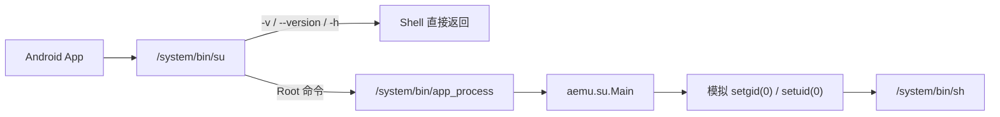

# AEmulator UID Shim

一个面向 [AEmulator](https://github.com/uxazu/aemulator) 的轻量级兼容 `su` 实现，让只检查 `su`、UID 或执行简单 Root Shell 命令的应用能够工作。

> [!WARNING]
> 这不是 Magisk，也不是真正的内核 Root。它没有授权弹窗、白名单、应用签名校验或权限数据库。任何能执行 `/system/bin/su` 的应用都会直接得到 AEmulator 模拟的 UID 0。不要在不可信环境中把它当作安全 Root 管理器使用。

本项目与 AEmulator 项目没有隶属关系，也没有包含 Magisk 或 AEmulator 的源代码。

## 为什么需要它

很多 ARM64 GSI 以 `system.img` 或 EXT4 系统镜像的形式发布。这类文件通常不包含可直接刷写的 `boot.img`、kernel 和 ramdisk，因此无法按普通 Android 设备上的方式安装 Magisk。

AEmulator 也不会启动完整的 Android Boot Chain。它直接运行 GSI 中的用户态程序，并由自己的 native runner 模拟部分 Linux 系统调用。Magisk 依赖的 systemless overlay、模块挂载、`init` 注入和 Zygisk 启动链都无法按原方式工作。

这个项目没有尝试绕过这些限制，而是实现一个最小兼容层：

1. 提供应用能够检测和执行的 `/system/bin/su`。
2. 调用 AEmulator 已经模拟的 `setuid(0)` / `setgid(0)`。
3. 以模拟 UID 0 启动 `/system/bin/sh`。

它适合 MT 管理器、文件管理工具、Root 检测工具以及通过 `su -c` 执行普通 Shell 命令的应用。

## 它不是

- 不是 Magisk。
- 不是内核漏洞或提权工具。
- 不是可撤销授权的 Root 管理器。
- 不提供真实的 Linux capabilities。
- 不支持 Magisk 模块、Zygisk、systemless hosts 或真实 mount namespace。
- 不建议用于银行、支付、账号安全或其他依赖强隔离的场景。

## 工作原理



`/system/bin/su` 是一个短小的 Shell 包装器：

- `su -v`、`--version`、`-h` 和 `--help` 直接在 Shell 层返回，避免为了版本探测启动昂贵的 Android Runtime。
- 实际 Root 命令通过 `app_process` 执行 [`aemu.su.Main`](src/aemu/su/Main.java)。
- Java 代码调用 `Os.setgid(0)` 和 `Os.setuid(0)`，随后启动 guest 的 `/system/bin/sh`。
- AEmulator 把这些调用映射为它所模拟的 UID/GID。

可以通过下面的结果观察它的边界：

```text
应用原始身份：
uid=10203(u0_a203)

应用执行 su -c id：
uid=0(root) gid=0(root) groups=0(root)

/proc/self/status 中的宿主 UID：
10461 10461 10461 10461
```

也就是说，guest 用户态会看到 UID 0，但宿主内核中的进程 UID 并没有改变。兼容层提供的是 AEmulator 层面的身份模拟，不具备真实 Root 的安全边界。

## 安全模型

这个项目没有安全授权模型。

安装后：

- `/system/bin/su` 的权限通常是 `0755`。
- 任何能执行该文件的 Android 应用都可以调用它。
- 不会弹出“允许/拒绝”窗口。
- Shizuku 的授权状态不影响这个兼容 `su`。
- 给文件改名或放到不常见路径只能降低被偶然发现的机会，不能阻止有意的应用找到并执行它。

如果不需要模拟 Root，应当卸载本项目，而不是依赖“隐藏”措施。

## 兼容性

### 已验证环境

| 项目 | 环境 |
| --- | --- |
| 模拟器 | AEmulator |
| 镜像 | LineageOS 23.0 VANILLA EXT4 GSI |
| Android | 16 |
| ABI | `arm64-v8a` |
| SELinux | AEmulator guest 中为 `Disabled` |
| 验证工具 | 普通测试 APK、MT 管理器、Shizuku |

### 一般适用范围

对 AEmulator 能够正常启动的 ARM64 GSI，本方案原则上通用，因为安装不需要 `boot.img`，也不修改 kernel。通常要求：

- GSI 可被 AEmulator 启动。
- GSI 是 `arm64-v8a`。
- 存在 `/system/bin/sh` 和 `/system/bin/app_process`。
- AEmulator 的 ADB 可以对 system 文件执行写入。
- GSI 没有其他不兼容的 `su` 实现。
- Android 版本至少为 5.0；当前 Java 实现使用 `android.system.Os`。

不同 Android 版本、ROM 和 AEmulator engine 仍可能产生差异。更换或重新导入 GSI 后，需要重新安装。

## 要求

### 仅安装预编译 JAR

- AEmulator 正在运行且可以连接 ADB。
- 主机上有 `adb`。
- GSI 的 `/system` 可写。

仓库中的 `dist/aemu-su.jar` 可直接用于安装。如果该文件不存在，安装脚本会尝试自动构建。

### 从源码构建

- JDK 17 或兼容版本。
- Android SDK。
- Android SDK Build-Tools，其中包含 `d8`。
- Android SDK Platform，其中包含 `android.jar`。

构建脚本会读取 `ANDROID_SDK_ROOT` 或 `ANDROID_HOME`，也会尝试常见的 SDK 安装路径。

## 快速开始

先连接 AEmulator 暴露的 ADB：

```sh
adb connect AEMULATOR_IP:5555
adb devices
```

将 `AEMULATOR_IP` 替换为 AEmulator 显示的地址；端口不一定是 `5555`，请以实际显示为准。

### Windows

从仓库根目录运行：

```powershell
.\scripts\build.ps1
.\scripts\install.ps1 -Serial AEMULATOR_IP:5555
```

如果只有一个在线设备，可以省略 `-Serial`：

```powershell
.\scripts\install.ps1
```

如果 PowerShell 阻止执行脚本：

```powershell
powershell -ExecutionPolicy Bypass -File .\scripts\install.ps1 -Serial AEMULATOR_IP:5555
```

### Linux / macOS

```sh
chmod +x scripts/*.sh src/su
./scripts/build.sh
./scripts/install.sh AEMULATOR_IP:5555
```

如果只有一个在线设备，可以省略序列号：

```sh
./scripts/install.sh
```

## 验证

安装后执行：

```sh
adb -s AEMULATOR_IP:5555 shell su -v
adb -s AEMULATOR_IP:5555 shell su -c id
```

预期结果：

```text
AEmulator UID shim 1.1.0 (not Magisk)
uid=0(root) gid=0(root) groups=0(root)
```

`su -v` 会在 Shell 层直接返回。`su -c id` 仍需要启动 `app_process`，在当前测试环境中约耗时 0.24 秒。

## 卸载

### Windows

```powershell
.\scripts\uninstall.ps1 -Serial AEMULATOR_IP:5555
```

### Linux / macOS

```sh
./scripts/uninstall.sh AEMULATOR_IP:5555
```

卸载脚本只会删除带有本项目标记的 `/system/bin/su`，同时删除 `/system/framework/aemu-su.jar`，避免误删 GSI 原有的 `su`。

## 覆盖已有 su

安装脚本检测到 `/system/bin/su` 存在且不属于本项目时，会默认拒绝覆盖。

确认要替换原有 `su` 时，可以显式使用强制模式：

```powershell
.\scripts\install.ps1 -Serial AEMULATOR_IP:5555 -Force
```

```sh
./scripts/install.sh --force AEMULATOR_IP:5555
```

## 常见问题

### 为什么 GSI 中没有 `boot.img`

GSI 通常是仅包含 system 分区的系统镜像。kernel、ramdisk 和 boot 配置不属于这种发布格式。Magisk 的安装流程依赖这些组件，因此不能在纯 GSI 文件上直接找到或修补 `boot.img`。

### 为什么不直接移植 Magisk

Magisk 不只是提供一个名为 `su` 的文件。它还依赖启动阶段、挂载、overlay、模块目录和 Zygisk 等机制。AEmulator 不执行真实 Android Boot Chain，也不执行本项目所依赖的真实 mount 操作，所以缺少完整移植条件。

### 为什么启用 Shizuku 后 MT 管理器启动变慢

MT 管理器可能同时探测 Root 和初始化 Shizuku Shell 通道。真正的 `su -c` 调用需要启动 Android Runtime，因此会产生额外开销。本项目的快速版本探测能消除 `su -v` 的主要耗时，但无法消除 Shizuku 自身的通信开销。

如果 MT 管理器不需要 Shell/Shizuku 功能，可以在“侧栏 → 三点菜单 → 设置”中关闭“请求 Shell 权限”，然后重启 MT 管理器。

### 为什么 Magisk Manager 仍然显示未安装 Magisk

本项目只提供兼容 `su`，没有实现 Magisk 的服务、配置、模块和版本协议。

### 为什么 `/proc/self/status` 中的 UID 不是 0

`su` 改变的是 AEmulator 模拟给 guest 的用户态身份，不会改变宿主内核记录的进程 UID。

### 换 GSI 后还需要安装吗

需要。兼容层安装在当前 GSI 的 system 文件中，不会自动进入另一个镜像。

## 项目结构

```text
.
├── dist/
│   └── aemu-su.jar
├── scripts/
│   ├── build.ps1
│   ├── build.sh
│   ├── install.ps1
│   ├── install.sh
│   ├── uninstall.ps1
│   └── uninstall.sh
└── src/
    ├── su
    └── aemu/su/Main.java
```

## 开发

修改 Java 源码后重新构建：

```powershell
.\scripts\build.ps1
```

```sh
./scripts/build.sh
```

构建会在 `build/` 中生成 class 和 DEX，并更新 `dist/aemu-su.jar`。

## 许可

本项目采用 [MIT License](LICENSE)。

AEmulator、Magisk、LineageOS、Android 及其他第三方项目的名称和代码归各自所有者所有。
